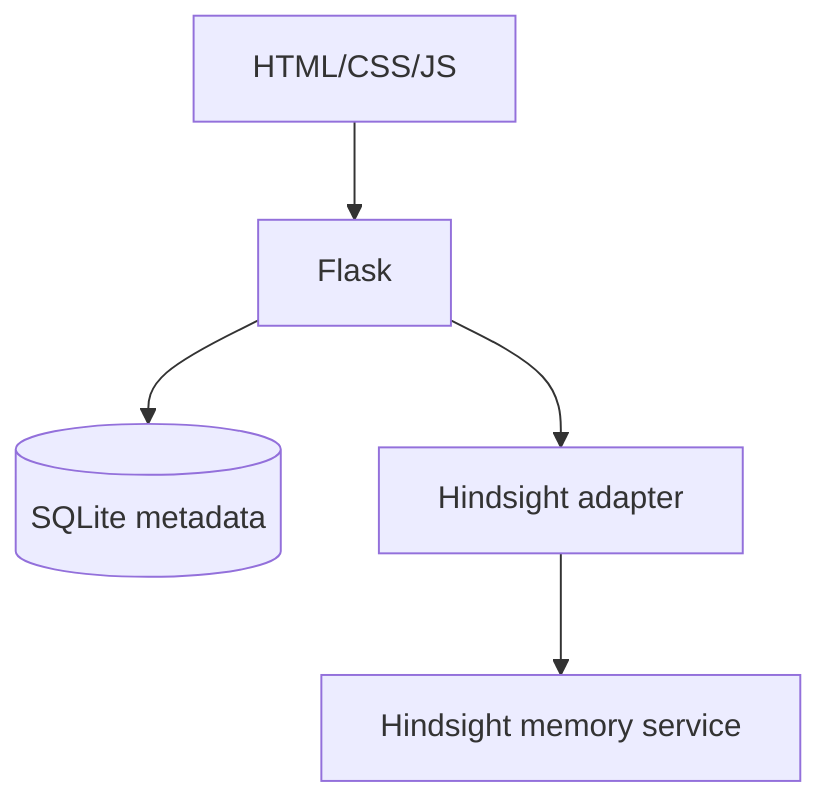

# ExperienceLoop

Organizational memory that learns from experience.

## Current prototype scope
This first increment includes a Flask dashboard, SQLite experience metadata, a capture form, validation, and an isolated Hindsight integration adapter. Investigation, recall, LLM reasoning, and feedback are intentionally not implemented yet.

## Setup
```bash
python -m venv .venv
# Windows: .venv\\Scripts\\activate
# macOS/Linux: source .venv/bin/activate
pip install -r requirements.txt
copy .env.example .env
```
Add your Hindsight API key to `.env`, then run:
```bash
python app.py
```
Open http://127.0.0.1:5000

Without Hindsight credentials, experiences are saved in SQLite and the UI reports that long-term memory is not configured. This is not represented as a successful Hindsight write.

## Architecture


## Important
The Hindsight adapter is isolated in `hindsight/client.py`. Confirm the installed Hindsight SDK constructor and `retain` signature against the version in your environment before treating the connection as verified. Never commit `.env`.
